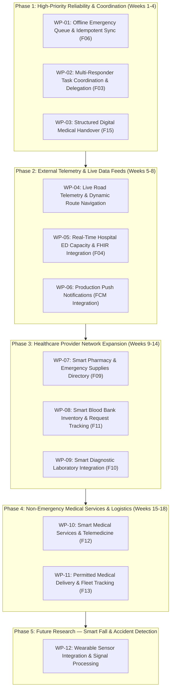

# Smart Aid — Engineering Implementation Roadmap & Dependency Backlog

**Project:** Smart Aid  
**Team:** FirstLine  
**Audit Date:** 2026-11-16  
**Auditor:** Technical Lead & Systems Architect  
**Objective:** Deliver an actionable, dependency-ordered engineering roadmap that bridges verified V1 implementation gaps without refactoring or rebuilding functioning components.

---

## 1. Roadmap Principles & Phasing Strategy

1. **Preserve What Works:** Working, verified modules (Idempotent SOS, Smart Dispatch, Smart ER Algorithm, ECC EMS Dashboard, Training Academy, Audit Logs) must remain intact.
2. **Strict Phasing Based on Architectural Dependencies:** Core data persistence and reliability (offline sync, task splitting) precede non-urgent vertical directories (pharmacy, blood bank, lab).
3. **Formal Boundary Enforcement:** Smart Fall & Accident Detection is maintained exclusively in Phase 5 as a long-term future hardware/ML research track.

---

## 2. Detailed Work Package Specifications

### WP-01: Offline Emergency Queue & Idempotent Sync (F06)
- **Current Status:** Not Implemented (Status: E).
- **Target Capability:** Allow citizen to capture an SOS while completely offline, cache locally in SQLite/Hive, and automatically synchronize upon reconnection with idempotency protection.
- **Dependencies:** Existing `V7__incident_idempotency.sql` table and `IncidentService.java` advisory locks.
- **Engineering Tasks:**
  - *Database:* Add client-side SQLite/Hive database table `offline_pending_incidents`.
  - *Frontend (Flutter):* Add `connectivity_plus` package, offline queue notifier, and background sync worker.
  - *Backend:* Endpoint `POST /api/incidents/sync` accepting batch or single queued incidents with original client-side timestamps.
  - *Security:* Idempotent deduplication using client UUID and request fingerprint.
- **Priority:** **CRITICAL**.
- **Effort Sizing:** Medium (2 Sprints).
- **Definition of Done:** Airplane mode enabled on mobile device -> User presses SOS -> App caches record -> Airplane mode disabled -> System transmits incident -> Server assigns incident with original timestamp -> Zero duplicate records created on network retries.

---

### WP-02: Multi-Responder Task Coordination & Delegation (F03)
- **Current Status:** Partially Implemented (Status: D - single volunteer + EMS only).
- **Target Capability:** Enable an incident to accept multiple verified responders and assign distinct sub-tasks (e.g. Responder 1: CPR; Responder 2: Retrieve nearby AED; Responder 3: Crowd control).
- **Dependencies:** Existing `SmartDispatchService.java` and `V3` emergency response tables.
- **Engineering Tasks:**
  - *Database:* Flyway migration `V8__multi_responder_tasks.sql` creating `incident_tasks` table and relaxing single-responder constraint on `emergency_responses`.
  - *Backend:* `TaskService.java` with atomic assignment methods `assignTask(incidentId, responderId, taskType)`.
  - *Frontend:* Multi-task dispatch view in Volunteer Dashboard and task delegation controls in EMS Command Center.
- **Priority:** **HIGH**.
- **Effort Sizing:** Medium (2 Sprints).
- **Definition of Done:** Single cardiac incident simultaneously dispatches Volunteer A for chest compressions and Volunteer B to retrieve Nile City Tower AED #1, tracking individual status and timestamps.

---

### WP-03: Structured Digital Medical Handover (F15)
- **Current Status:** Partially Implemented (Status: D - status history transition notes only).
- **Target Capability:** Standardized digital transfer of patient vitals, administered pre-hospital care, and emergency profile data to receiving hospital staff with digital acknowledgment.
- **Dependencies:** Existing `IncidentStatusHistory`, `MedicalProfile`, and `EmsService`.
- **Engineering Tasks:**
  - *Database:* Flyway migration `V12__digital_medical_handover.sql` creating `medical_handovers` table.
  - *Backend:* `HandoverController.java` with endpoints `POST /api/handovers` and `POST /api/handovers/{id}/acknowledge`.
  - *Frontend:* EMS mobile handover summary screen and hospital reception PIN/signature confirmation.
- **Priority:** **HIGH**.
- **Effort Sizing:** Low (1 Sprint).
- **Definition of Done:** EMS arrives at hospital (`AT_HOSPITAL`), generates structured handover containing incident vitals and allergies; receiving hospital staff confirms receipt, transitioning incident to `RESOLVED` with complete tamper-evident audit record.

---

### WP-04 & WP-05: Live Telemetry, Routing & Hospital EHR Integration
- **Current Status:** Simulated (Status: C - straight-line Haversine math and database-stored congestion).
- **Target Capability:** Replace 30/39 km/h straight-line distance with live traffic routes via Google Maps Platform Routes API and ingest live hospital emergency bay occupancy via HL7 FHIR feeds.
- **Dependencies:** Existing `SmartErService.java` and `SmartDispatchService.java`.
- **Priority:** **HIGH**.
- **Effort Sizing:** Large (3 Sprints).
- **Definition of Done:** Smart ER recalculates destination scores dynamically based on actual real-time rush hour traffic times and live hospital emergency bed availability.

---

### WP-07, WP-08 & WP-09: Healthcare Network Extensions (Pharmacy, Blood Bank, Lab)
- **Current Status:** Not Implemented (Status: E).
- **Target Capabilities:**
  - *WP-07 (Pharmacy & Emergency Supplies - F09):* Directory of 24-hour pharmacies stocking emergency first-aid supplies.
  - *WP-08 (Blood Bank - F11):* Inventory tracking for rare blood groups and urgent blood dispatch requests.
  - *WP-09 (Lab - F10):* Directory of diagnostic medical laboratories and test availability.
- **Dependencies:** Core emergency lifecycle completion (Phase 1 & Phase 2).
- **Priority:** **MEDIUM**.
- **Effort Sizing:** Large (4 Sprints total).
- **Definition of Done:** Registered pharmacies update first-aid stock; blood banks receive critical blood group requests from EMS; diagnostic labs list available urgent tests.

---

### WP-12: Formal Future Research — Smart Fall & Accident Detection
- **Current Status:** Proposed Future Development.
- **Scope:** Wearable Bluetooth Low Energy (BLE) sensor integration, accelerometer/gyroscope signal processing, threshold-based fall detection, countdown confirmation, and automated alert triggering.
- **Priority:** **RESEARCH TRACK (Post-V1)**.
- **Effort Sizing:** Dedicated Future Project Phase.

---

*Approved for engineering release by Technical Lead on 2026-11-16.*
