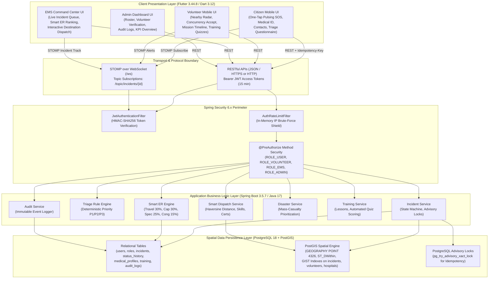

# Smart Aid — System Architecture Audit: As-Built vs. Target Architecture

**Project:** Smart Aid  
**Team:** FirstLine  
**Audit Date:** 2026-11-16  
**Auditor:** Master Technical Auditor & Software Architect  
**Architecture Paradigm:** Native Single-Machine Monolith (No Containerization)  

---

## 1. Executive Architecture Summary

Smart Aid is implemented as a **3-tier native application** engineered specifically for deterministic performance on single-machine or local networks. It eschews cloud containerization (Docker/Kubernetes) in favor of high-throughput direct execution on the host OS.

The platform coordinates four live personas:
1. **Citizen / Reporter** (Flutter Mobile)
2. **Field Volunteer Responder** (Flutter Mobile)
3. **Emergency Medical Services (EMS) Dispatcher** (Flutter Web / Mobile Emergency Command Center)
4. **System Administrator** (Flutter Web / Mobile Admin Console)

---

## 2. As-Built Architecture (Verified Implementation)

The diagram below depicts **only** components, protocols, and data stores whose executable source code, schemas, and test suites have been verified in the repository.



---

## 3. Target Architecture (Complete 17-Feature Concept)

The target architecture below illustrates the intended full vision, with **unimplemented or planned components explicitly labeled as [PROPOSED / PLANNED]**.

```mermaid
graph TD
    subgraph Clients ["Target Client Applications"]
        MobileApp["Unified Smart Aid Mobile App<br/>(Citizen, Volunteer, EMS, Hospital)"]
        WebEcc["Dedicated Web Command Center (ECC)<br/>(Multi-Screen Operator Console)"]
        Wearable["[PROPOSED] Wearable Sensor Device<br/>(Smart Fall & Accident Detection)"]
    end

    subgraph Gateways ["API & Security Gateway"]
        ApiGw["Enterprise Gateway & Load Balancer"]
        OfflineQueue["[PROPOSED] Local SQLite/Hive Offline Sync Queue"]
    end

    subgraph Verified_Modules ["Verified Core Backend Modules"]
        CoreAuth["Auth, RBAC & Token Rotation"]
        CoreSos["SOS Intake & Idempotency"]
        CoreTriage["Structured Triage Support"]
        CoreDispatch["Smart Dispatch (Single Volunteer)"]
        CoreSmartEr["Smart ER Multi-Factor Ranking"]
        CoreDisaster["Disaster Management Mode"]
        CoreTraining["Training Academy"]
        CoreAudit["Immutable Audit Trails"]
    end

    subgraph Proposed_Modules ["[PROPOSED / UNIMPLEMENTED] Capability Modules"]
        TaskCoord["[PROPOSED] Multi-Responder Task Splitting<br/>(CPR, AED, Crowd Control)"]
        OfflineSync["[PROPOSED] Offline Sync Engine & Conflict Resolver"]
        PharmacyModule["[PROPOSED] Smart Pharmacy & Emergency Supplies"]
        LabModule["[PROPOSED] Smart Lab & Diagnostics Sharing"]
        BloodBankModule["[PROPOSED] Smart Blood Bank & Request Dispatch"]
        MedicalSvcModule["[PROPOSED] Smart Medical Services (Clinics, Telemedicine)"]
        DeliveryModule["[PROPOSED] Permitted Medical Supply Delivery"]
        HandoverModule["[PROPOSED] Digital Medical Handover & Signature"]
        AccidentDetection["[PROPOSED] Wearable Signal Processing / Fall Engine"]
    end

    subgraph External_Systems ["External Integrations"]
        LiveTraffic["[PROPOSED] Google Maps Platform / OSRM Live Routes API"]
        HospitalEhr["[PROPOSED] Hospital HL7 / FHIR Live Capacity Feeds"]
        FcmPush["[PROPOSED] Firebase Cloud Messaging (Lock-Screen Push)"]
    end

    MobileApp --> ApiGw
    WebEcc --> ApiGw
    Wearable -.->|[PROPOSED Bluetooth/BLE]| MobileApp
    MobileApp --> OfflineQueue
    OfflineQueue -.->|[PROPOSED Sync]| OfflineSync

    ApiGw --> CoreAuth
    ApiGw --> CoreSos
    ApiGw --> CoreTriage
    ApiGw --> CoreDispatch
    ApiGw --> CoreSmartEr
    ApiGw --> CoreDisaster
    ApiGw --> CoreTraining
    ApiGw --> CoreAudit

    ApiGw -.-> TaskCoord
    ApiGw -.-> OfflineSync
    ApiGw -.-> PharmacyModule
    ApiGw -.-> LabModule
    ApiGw -.-> BloodBankModule
    ApiGw -.-> MedicalSvcModule
    ApiGw -.-> DeliveryModule
    ApiGw -.-> HandoverModule
    ApiGw -.-> AccidentDetection

    CoreDispatch -.->|[PROPOSED]| LiveTraffic
    CoreSmartEr -.->|[PROPOSED]| HospitalEhr
    CoreSos -.->|[PROPOSED]| FcmPush
```

---

## 4. Architectural Analysis: Trust Boundaries, Data Flows & Single Points of Failure

### 4.1 Trust Boundaries
1. **Client-Server Boundary:**
   - Transport: Cleartext HTTP/WS in local testing; TLS 1.3 required in production.
   - Authentication: Stateless short-lived JWT access tokens (15-minute validity) signed via HMAC-SHA256 (`JwtService.java`).
   - Refresh tokens (14-day validity) are stored strictly as SHA-256 hashes in `refresh_tokens` table with single-use rotation. Replay of spent refresh tokens immediately invalidates all active sessions for that user account.
2. **Authorization Boundary:**
   - Role-Based Access Control (RBAC) enforced server-side using `@PreAuthorize("hasRole(...)")`.
   - Data ownership checks: A citizen can only access their own incident history (`/api/incidents/mine`) and medical profile (`/api/medical-profile`). Cross-tenant access is rejected with `403 FORBIDDEN`.
3. **Pessimistic Concurrency Boundary:**
   - In `VolunteerService.java`, volunteer acceptance executes inside a `@Transactional` block with database-level row locking:
     `SELECT * FROM incidents WHERE id = :id FOR UPDATE;`
   - This ensures absolute atomic assignment: only the first volunteer to accept transitions the incident to `RESPONDER_ASSIGNED`; subsequent concurrent attempts are rejected with `409 CONFLICT`.

### 4.2 Single Points of Failure (SPOF)
1. **Single-Node PostgreSQL Instance:**
   - In the native deployment, PostgreSQL 18 is running as a single local service on port 5432. A crash of the database halts all API intake, dispatching, and audit logging.
   - *Mitigation:* Master-replica replication or managed cloud PostgreSQL with automated failover for production release.
2. **In-Memory Rate Limiting (`AuthRateLimitFilter.java`):**
   - The brute-force rate limiter stores request counts in an in-memory `ConcurrentHashMap`. Restarting the backend process clears all rate-limit counters.
   - *Mitigation:* Backing the rate limiter with a persistent distributed cache (e.g. Redis) for clustered deployments.
3. **Lack of Offline Client Persistence:**
   - If the mobile device loses network connectivity before submitting an SOS or accepting a mission, the request fails with a network exception (`DioException`). No local SQLite/Hive queue exists to buffer requests.
   - *Mitigation:* Implementation of a local persistent queue (see Roadmap Phase 2).

---

*Audited and certified by Master Software Architect on 2026-11-16.*
